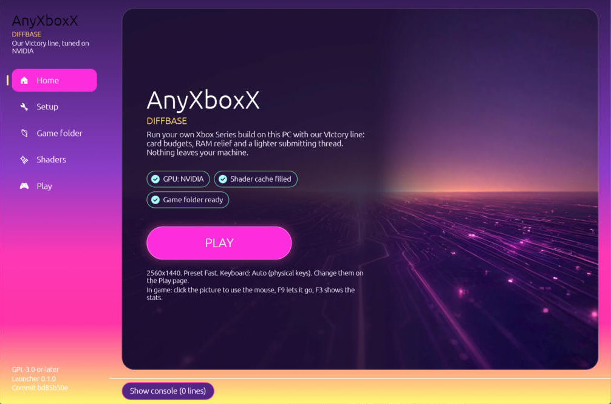
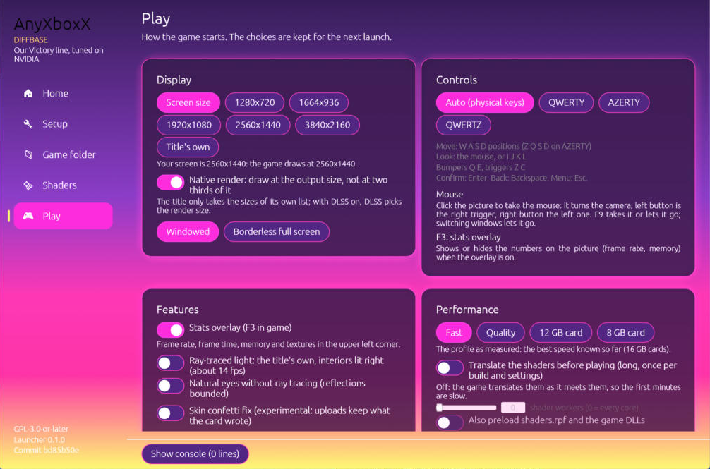

# AnyXboxX diffbase

**English** · [Français](docs/i18n/README.fr.md)

AnyXboxX diffbase is our own line of [AnyXboxX](https://github.com/LooperSalty/AnyXboxX) and of its graphics engine, [VIctory](https://github.com/Marvisak/VIctory). It runs your own copy of the Xbox Series build 1.0.2.1 of Grand Theft Auto VI on a Windows PC, and it is tuned and measured on an NVIDIA RTX card. It keeps the engine base that upstream AnyXboxX had on 26 November 2026, the "combined base", and adds our performance and picture work on top. Upstream has since moved to another engine base (Vice-Tay, [LooperSalty/AnyXboxX#454](https://github.com/LooperSalty/AnyXboxX/pull/454)). This line diverges from it on purpose and is not sent upstream.

This repository contains no game files, no game code, no keys and no console or SDK files, and it does not explain how to get them. You need your own legally obtained copy of the game.



> [!NOTE]
> **Where we are (2026-11-27, evening).** The first cutscene runs at about 25 fps in most seconds at native 2560x1440 on an RTX 5080, up from about 10 fps on the combined base, with dips at its scene cuts. Its frames are steadier: in the same shot, 5% of frames take over 50 ms, against 12% in the morning's build. With ray tracing on, it runs at about 14 fps, up from about 6. The open world (a save at the docks) runs at about 20-25 fps, with texture pop-in, one-frame texture swaps and dark blocks on the water still to fix.

## Measured gains

Setup: first cutscene, 2560x1440 native (`VICTORY_OUTPUT=2560x1440`, `VICTORY_RENDER_SCALE=1.0`), Series X profile. RTX 5080, Ryzen 7 9800X3D, 31 GB of RAM, Windows 11. The fps figures come from the game's own frame counter.

| Build | fps over the scene | Median second | Low (10th percentile) |
|---|---|---|---|
| Combined base (VIctory's `play.ps1` set) | 9.9 | 10.4 | 7.6 |
| + card budgets and RAM relief | 20.8 | 22.7 | 16.1 |
| + submission-thread fixes | 22.8 | 26.7 | 18.6 |
| + the evening's set: memory line off the submitting thread, card steps that no longer wait for every flight, picture fixes (this line's set) | 22.0 | 25.2 | 15.0 |

- **GPU work per frame** fell from 82.8 ms to 28.5 ms with the card budgets: the title's buffers stay in the card's memory, with a reservation, instead of being read by the GPU from the PC's memory.
- **Ray tracing on** (`VICTORY_BVH_BUILDER=1`, correct indoor lighting): about 14 fps, up from about 6.
- **Steadier frames**: the memory-by-owner line walked the process heap under its lock on the submitting thread, one 300-460 ms frame every 10 s. It no longer does. In the cell-window shot, frames over 50 ms fell from 11.9% to 5.1%.
- **Scene cuts** still stall for 240-570 ms, and how many land in the measured span varies from run to run: that is what the "fps over the scene" and "Low" columns of the last row show, not the steady shots.
- **Caveats**: each build was measured once, on about 2 minutes of the same cutscene, on one machine. The open world has not been measured with this line yet. The game caps itself at 30 fps.

## Requirements

- Windows 10 or 11, 64-bit, with an AVX2 processor.
- A Direct3D 12 graphics card with shader model 6.6 and mesh shaders. **An NVIDIA RTX card is recommended**: this line is tuned and measured on an RTX 5080 (16 GB). On AMD the launcher uses VIctory's own measured set, without this line's additions. The presets for 8 and 12 GB cards are not measured.
- 32 GB of RAM: the game uses about 30 GB. Keep more than 30 GB free on the system drive, because the shader cache grows as you play.
- Your own legally obtained copy of the Xbox Series 1.0.2.1 build: a folder that contains `game_scarlett_master.exe`. It is not provided.
- [Git](https://git-scm.com/), [Rust through rustup](https://rustup.rs/), and Visual Studio 2022 or 2026 Build Tools with the "Desktop development with C++" workload. VIctory is built from source the first time you play.
- Optional, for DLSS: an `nvngx_dlss.dll` that you already have from another game. It is never shipped here.

## Build and run

### With the launcher (recommended)

```powershell
git clone --recurse-submodules https://github.com/Skyfrye/anyXboxx-diffbase.git
cd anyXboxx-diffbase
cargo build --release -p anyxboxx-launcher
.\target\release\anyxboxx-launcher.exe
```

1. **Setup** page: every line must be green or explained (Rust, the Direct3D 12 runtime, the VC++ redistributable, the GPU driver).
2. **Game folder** page: pick the folder that holds `game_scarlett_master.exe`. You can also drop the folder on the window. The launcher only reads it: it never copies or changes the game's files.
3. **Play** page: the output size defaults to your screen's (the largest of the title's own sizes that fits it), rendered at native size. Switch the optional features you want on (see below).
4. **Home**: press **PLAY**. The first time, the launcher builds VIctory (several minutes, once), then starts the game.

The first run is slow while the game's shaders are translated, often well under 1 fps for a while. Judge the speed from the second run. You can also translate them before playing: turn on "Translate the shaders before playing" on the Play page, or use the **Shaders** page.

If a `victory.exe` sits next to `anyxboxx-launcher.exe`, the launcher uses it as it is and builds nothing. `--victory-exe <path>` does the same for a `victory.exe` elsewhere.

### From the command line

```powershell
cargo build --release -p anyxboxx
.\target\release\anyxboxx.exe run --game-dir <game folder> --profile diffbase --override VICTORY_OUTPUT=2560x1440 --override VICTORY_RENDER_SCALE=1.0 --override VICTORY_PANEL=1
```

`--profile diffbase` gives VIctory this line's measured set, the same one the launcher uses on NVIDIA. Without `--profile`, `anyxboxx run` uses VIctory's own `play.ps1` set. `VICTORY_OUTPUT` takes only the title's own sizes: 1280x720, 1664x936, 1920x1080, 2560x1440 and 3840x2160. More options are in [docs/running-gta6.md](docs/running-gta6.md).

## The launcher

The launcher checks your machine, verifies your game folder, builds or finds `victory.exe`, and starts the game with this line's settings. It does not contain or download any game file. Its pictures were made for this project (see [crates/anyxboxx-launcher/assets](crates/anyxboxx-launcher/assets/README.md)). It uses no art, logo or trademark from the game.

| Feature | Switch | Default | What it does |
|---|---|---|---|
| Stats overlay | `VICTORY_PANEL=1` | on | Frame rate, frame time, memory and textures on the picture. F3 shows or hides it in game. |
| Output size | `VICTORY_OUTPUT` | your screen | The size the game draws at, from the title's own list. |
| Native render | `VICTORY_RENDER_SCALE=1.0` | on | Renders at the output size instead of at two thirds of it. |
| Ray-traced light | `VICTORY_BVH_BUILDER=1` | off | The title's own ray-traced indirect light: interiors are lit correctly, at about 14 fps. |
| Natural eyes | `VICTORY_AMBIENT_SPECULAR=1.5` | off | Bounds the reflections, so eyes look natural without ray tracing. |
| Skin confetti fix | `VICTORY_FIRST_UPLOAD_FRONT=1` | off | Experimental fix for the coloured specks that sometimes appear on skin. |
| NVIDIA DLSS | `VICTORY_DLSS=1`, `VICTORY_DLSS_DLL`, `VICTORY_DLSS_MODE` | off | DLSS upscales in place of the title's FidelityFX. Needs your own `nvngx_dlss.dll`. Experimental: not measured in game yet. |



The Play page also has presets for 12 GB and 8 GB cards (not measured), the window mode, the keyboard layout, NVIDIA Smooth Motion, and an Advanced panel where any `VICTORY_*` value can be overridden.

**Logs**: each game run writes `logs\game-<time>.log` next to the launcher. The log starts with the command and every VIctory setting used. If that folder cannot be written, the log goes to `%LOCALAPPDATA%\AnyXboxX-diffbase\logs` instead. The launcher's settings are kept in `%LOCALAPPDATA%\AnyXboxX-diffbase\launcher\settings.toml`. The full guide is in [docs/launcher.md](docs/launcher.md).

### Controls

- **Move**: W A S D (Z Q S D on AZERTY, by key position). **Look**: the mouse, or I J K L.
- **Mouse**: click the picture to take the mouse. It then turns the camera, the left button is the right trigger and the right button is the left trigger. F9 takes the mouse or lets it go, and switching to another window lets it go.
- **F3**: shows or hides the stats overlay.
- Confirm: Enter. Back: Backspace. Menu: Esc. A gamepad works too.

## What differs from upstream AnyXboxX

| | Upstream AnyXboxX | This line |
|---|---|---|
| Engine base | Vice-Tay ([LooperSalty/AnyXboxX#454](https://github.com/LooperSalty/AnyXboxX/pull/454)) | The combined base of 26 November, plus our work |
| Tuned on | AMD (RX 7900 XTX on Windows, RX 9070 XT on Linux) | NVIDIA (RTX 5080) |
| NVIDIA settings | VIctory's `play.ps1` set, not measured on NVIDIA | Measured set: card budgets, RAM relief, submission-thread switches, the picture fixes (skin, eyes, intro video), no `VICTORY_CARD_AWAKE` |
| Output size | The console's 3840x2160, rendered at two thirds | The screen's size, rendered at native size |
| DLSS | No | Yes, experimental (`VICTORY_DLSS=1`) |
| Stats overlay | Diagnostics builds only | Release builds too (F3) |
| Launcher | Profiles and presets | Our profile, an output size, the optional features above, logs next to it, original art |

### Lineage of the engine

The engine is `third_party/victory`:

- **Combined base**: [avatarmanz/VIctory-7900XTX](https://github.com/avatarmanz/VIctory-7900XTX) `c9c932c` merged with [codec-d/cool_fox](https://github.com/codec-d/cool_fox) `f4b48ad`, plus upstream AnyXboxX's fixes.
- **Round 1**: list translation brought from 27–38 µs to 4 µs a call on NVIDIA.
- **Round 2**: settles, GPU overhead, mouse input, stability, and review fixes.
- **Vice-Tay ports**: card budgets with a reservation, RAM relief under memory pressure, and BC7 decode fixes.
- **Fixes**: the bake stamp, and the submission thread (helpers above normal, a core of its own, the D3D runtime's background threads on the first cores).
- **Ray tracing**: pages that will never arrive no longer slow the structure walks.
- **Picture**: the reflection bound (`VICTORY_AMBIENT_SPECULAR`), the skin confetti fix (`VICTORY_FIRST_UPLOAD_FRONT`), light tiles in rows on NVIDIA (no blocks or stripes of light), and the intro video's planes in their own upload buffers (`VICTORY_MOVIE_PLANES`, no colour-only frames).
- **Hitches**: card steps read a copy's source instead of waiting for every flight (`VICTORY_PLACED_SOURCE`), and the memory line no longer locks the process heap.
- **Additions**: NVIDIA DLSS (`VICTORY_DLSS=1`), and the stats overlay in release builds.

Every source and its author is credited in [THIRD_PARTY.md](THIRD_PARTY.md).

## Known issues

- Textures sometimes swap to another image, or show noise, for a single frame, and some appear late (pop-in).
- In the open world, dark rectangular blocks show on the water.
- Scene cuts in the first cutscene stall for 240-570 ms while their pipelines are made.
- Some interiors show blocky bands.
- The game caps itself at 30 fps.
- The game uses about 30 GB of RAM.
- The first run is slow while the shaders are translated.
- DLSS has not been measured in game yet.

## Repository checks

| Check | Status |
|---|---|
| 1900+ automated tests | ✅ |
| English and French READMEs kept in sync (rows, images, test count) | ✅ |

```powershell
py -3.12 -m venv .venv
.\.venv\Scripts\python.exe -m pip install -r requirements.txt -r requirements-dev.txt
.\.venv\Scripts\python.exe -m pytest
cargo test --release -p anyxboxx -p anyxboxx-launcher
```

The tests that need the C++ runtime are skipped when it is not built. GPU tests need `dxc` and the GPU runner; without a GPU they use WARP. The layout of the repository and its rules are in [AGENTS.md](AGENTS.md).

## License

This line is distributed under the [GNU GPL 3.0 or later](LICENSE), like upstream AnyXboxX and VIctory. Third-party parts keep their own licence, and every source is credited in [THIRD_PARTY.md](THIRD_PARTY.md).

DLSS support is code we wrote from the public declarations of NVIDIA's DLSS SDK. No NVIDIA file is copied, linked or shipped, and the DLSS model (`nvngx_dlss.dll`) comes from you. Whether this use fits the GPL has not been checked by a lawyer.
