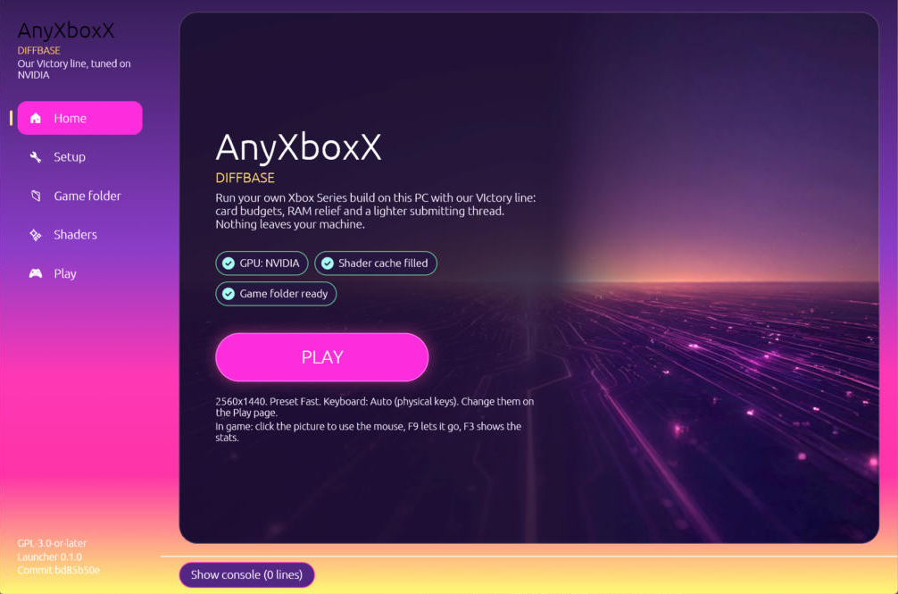
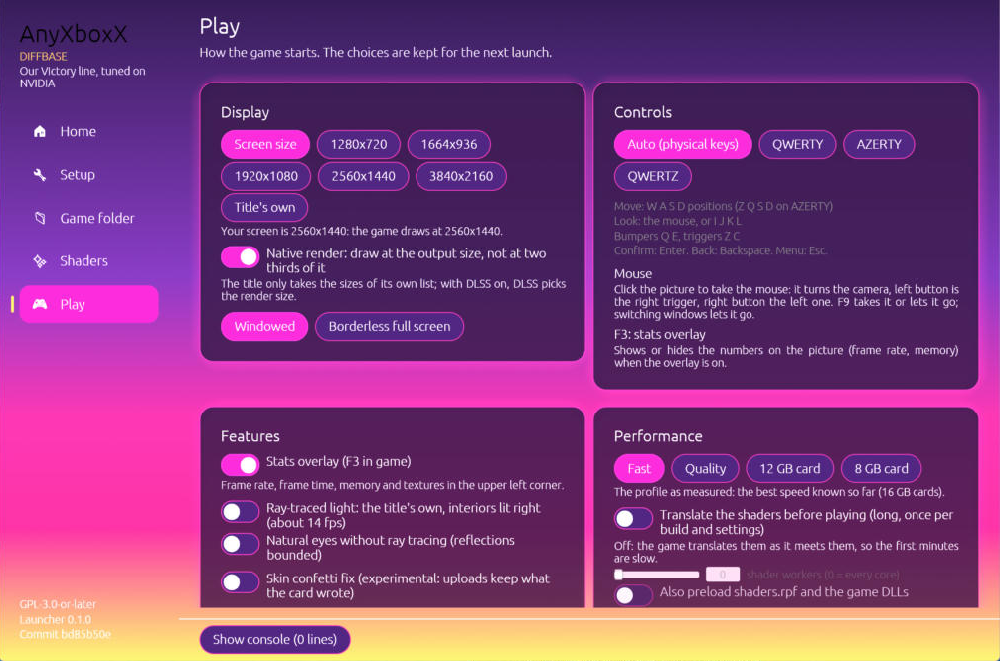

# AnyXboxX diffbase

[English](../../README.md) · **Français**

AnyXboxX diffbase est notre propre lignée d'[AnyXboxX](https://github.com/LooperSalty/AnyXboxX) et de son moteur graphique, [VIctory](https://github.com/Marvisak/VIctory). Elle fait tourner votre propre copie du build Xbox Series 1.0.2.1 de Grand Theft Auto VI sur un PC Windows, et elle est réglée et mesurée sur une carte NVIDIA RTX. Elle garde la base de moteur qu'AnyXboxX avait le 26 novembre 2026, la « base combinée », et y ajoute notre travail sur les performances et l'image. L'amont est depuis passé à une autre base de moteur (Vice-Tay, [LooperSalty/AnyXboxX#454](https://github.com/LooperSalty/AnyXboxX/pull/454)). Cette lignée s'en écarte volontairement et n'est pas renvoyée vers l'amont.

Ce dépôt ne contient aucun fichier du jeu, aucun code du jeu, aucune clé et aucun fichier de console ou de SDK, et n'explique pas comment les obtenir. Il vous faut votre propre copie du jeu, obtenue légalement.



> [!NOTE]
> **Où nous en sommes (2026-11-27).** La première cinématique tourne à environ 23 fps en 2560x1440 natif sur une RTX 5080, contre environ 10 fps sur la base combinée. Avec le ray tracing, elle tourne à environ 14 fps, contre environ 6. Le monde ouvert n'est pas encore mesuré.

## Gains mesurés

Conditions : première cinématique, 2560x1440 natif (`VICTORY_OUTPUT=2560x1440`, `VICTORY_RENDER_SCALE=1.0`), profil Series X. RTX 5080, Ryzen 7 9800X3D, 31 Go de RAM, Windows 11. Les fps viennent du compteur d'images du jeu lui-même.

| Build | fps sur la scène | Seconde médiane | Bas (10e centile) |
|---|---|---|---|
| Base combinée (réglages `play.ps1` de VIctory) | 9,9 | 10,4 | 7,6 |
| + budgets sur la carte et allègement de la RAM | 20,8 | 22,7 | 16,1 |
| + correctifs du thread de soumission (réglages de cette lignée) | 22,8 | 26,7 | 18,6 |

- **Travail du GPU par image** : de 82,8 ms à 28,5 ms avec les budgets sur la carte. Les tampons du titre restent dans la mémoire de la carte, avec une réservation, au lieu d'être lus par le GPU dans la mémoire du PC.
- **Ray tracing actif** (`VICTORY_BVH_BUILDER=1`, éclairage intérieur correct) : environ 14 fps, contre environ 6.
- **Réserves** : chaque build a été mesuré une fois, sur environ 2 minutes de la même cinématique, sur une seule machine. Le monde ouvert n'a pas encore été mesuré avec cette lignée. Le jeu se limite lui-même à 30 fps.

## Configuration requise

- Windows 10 ou 11, 64 bits, avec un processeur AVX2.
- Une carte graphique Direct3D 12 avec le shader model 6.6 et les mesh shaders. **Une carte NVIDIA RTX est recommandée** : cette lignée est réglée et mesurée sur une RTX 5080 (16 Go). Sur AMD, le lanceur utilise les réglages mesurés de VIctory, sans les ajouts de cette lignée. Les préréglages pour cartes de 8 et 12 Go ne sont pas mesurés.
- 32 Go de RAM : le jeu en utilise environ 30. Gardez plus de 30 Go libres sur le disque système, car le cache de shaders grossit pendant le jeu.
- Votre propre copie du build Xbox Series 1.0.2.1, obtenue légalement : un dossier qui contient `game_scarlett_master.exe`. Elle n'est pas fournie.
- [Git](https://git-scm.com/), [Rust via rustup](https://rustup.rs/), et les Build Tools de Visual Studio 2022 ou 2026 avec la charge « Développement Desktop en C++ ». VIctory est compilé depuis les sources au premier lancement.
- Facultatif, pour DLSS : un `nvngx_dlss.dll` que vous avez déjà, venu d'un autre jeu. Il n'est jamais fourni ici.

## Compiler et lancer

### Avec le lanceur (recommandé)

```powershell
git clone --recurse-submodules https://github.com/Skyfrye/anyXboxx-diffbase.git
cd anyXboxx-diffbase
cargo build --release -p anyxboxx-launcher
.\target\release\anyxboxx-launcher.exe
```

1. Page **Setup** : chaque ligne doit être verte ou expliquée (Rust, le runtime Direct3D 12, le redistribuable VC++, le pilote du GPU).
2. Page **Game folder** : choisissez le dossier qui contient `game_scarlett_master.exe`. Vous pouvez aussi déposer le dossier sur la fenêtre. Le lanceur ne fait que le lire : il ne copie ni ne modifie jamais les fichiers du jeu.
3. Page **Play** : la taille de sortie est par défaut celle de votre écran (la plus grande des tailles du titre qui y tient), rendue en natif. Activez les fonctions facultatives voulues (voir plus bas).
4. **Home** : appuyez sur **PLAY**. La première fois, le lanceur compile VIctory (plusieurs minutes, une seule fois), puis démarre le jeu.

Le premier lancement est lent pendant la traduction des shaders du jeu, souvent bien en dessous de 1 fps pendant un moment. Jugez la vitesse au deuxième lancement. Vous pouvez aussi les traduire avant de jouer : activez « Translate the shaders before playing » sur la page Play, ou utilisez la page **Shaders**.

Si un `victory.exe` se trouve à côté d'`anyxboxx-launcher.exe`, le lanceur l'utilise tel quel et ne compile rien. `--victory-exe <chemin>` fait de même pour un `victory.exe` ailleurs.

### En ligne de commande

```powershell
cargo build --release -p anyxboxx
.\target\release\anyxboxx.exe run --game-dir <dossier du jeu> --profile diffbase --override VICTORY_OUTPUT=2560x1440 --override VICTORY_RENDER_SCALE=1.0 --override VICTORY_PANEL=1
```

`--profile diffbase` donne à VIctory les réglages mesurés de cette lignée, ceux que le lanceur utilise sur NVIDIA. Sans `--profile`, `anyxboxx run` utilise les réglages `play.ps1` de VIctory. `VICTORY_OUTPUT` ne prend que les tailles du titre : 1280x720, 1664x936, 1920x1080, 2560x1440 et 3840x2160. Plus d'options dans [docs/fr/lancer-gta6.md](../fr/lancer-gta6.md).

## Le lanceur

Le lanceur vérifie votre machine et votre dossier de jeu, compile ou trouve `victory.exe`, et démarre le jeu avec les réglages de cette lignée. Il ne contient ni ne télécharge aucun fichier du jeu. Ses images ont été faites pour ce projet (voir [crates/anyxboxx-launcher/assets](../../crates/anyxboxx-launcher/assets/README.md)). Il n'utilise aucune image, aucun logo ni aucune marque du jeu.

| Fonction | Interrupteur | Par défaut | Effet |
|---|---|---|---|
| Statistiques à l'écran | `VICTORY_PANEL=1` | activé | Fréquence d'images, temps d'image, mémoire et textures sur l'image. F3 les montre ou les cache en jeu. |
| Taille de sortie | `VICTORY_OUTPUT` | votre écran | La taille à laquelle le jeu dessine, prise dans la liste du titre. |
| Rendu natif | `VICTORY_RENDER_SCALE=1.0` | activé | Rend à la taille de sortie au lieu des deux tiers. |
| Lumière en ray tracing | `VICTORY_BVH_BUILDER=1` | désactivé | La lumière indirecte en ray tracing du titre : intérieurs bien éclairés, à environ 14 fps. |
| Yeux naturels | `VICTORY_AMBIENT_SPECULAR=1.5` | désactivé | Borne les reflets, pour des yeux naturels sans ray tracing. |
| Correctif des confettis sur la peau | `VICTORY_FIRST_UPLOAD_FRONT=1` | désactivé | Correctif expérimental des points colorés qui apparaissent parfois sur la peau. |
| NVIDIA DLSS | `VICTORY_DLSS=1`, `VICTORY_DLSS_DLL`, `VICTORY_DLSS_MODE` | désactivé | DLSS met à l'échelle à la place du FidelityFX du titre. Demande votre propre `nvngx_dlss.dll`. Expérimental : pas encore mesuré en jeu. |



La page Play propose aussi des préréglages pour cartes de 12 et 8 Go (non mesurés), le mode de fenêtre, la disposition du clavier, NVIDIA Smooth Motion, et un panneau Advanced où toute valeur `VICTORY_*` peut être remplacée.

**Journaux** : chaque partie écrit `logs\game-<heure>.log` à côté du lanceur. Le journal commence par la commande et chaque réglage de VIctory utilisé. Si ce dossier ne peut pas être écrit, le journal va dans `%LOCALAPPDATA%\AnyXboxX-diffbase\logs`. Les réglages du lanceur sont gardés dans `%LOCALAPPDATA%\AnyXboxX-diffbase\launcher\settings.toml`. Le guide complet est dans [docs/fr/lanceur.md](../fr/lanceur.md).

### Commandes

- **Se déplacer** : W A S D (Z Q S D en AZERTY, par position des touches). **Regarder** : la souris, ou I J K L.
- **Souris** : cliquez sur l'image pour prendre la souris. Elle tourne alors la caméra, le bouton gauche est la gâchette droite et le bouton droit la gâchette gauche. F9 prend la souris ou la lâche, et passer à une autre fenêtre la lâche.
- **F3** : montre ou cache les statistiques à l'écran.
- Valider : Entrée. Retour : Retour arrière. Menu : Échap. Une manette marche aussi.

## Ce qui diffère d'AnyXboxX en amont

| | AnyXboxX en amont | Cette lignée |
|---|---|---|
| Base du moteur | Vice-Tay ([LooperSalty/AnyXboxX#454](https://github.com/LooperSalty/AnyXboxX/pull/454)) | La base combinée du 26 novembre, plus notre travail |
| Réglé sur | AMD (RX 7900 XTX sous Windows, RX 9070 XT sous Linux) | NVIDIA (RTX 5080) |
| Réglages NVIDIA | Ceux de `play.ps1`, non mesurés sur NVIDIA | Réglages mesurés : budgets sur la carte, allègement de la RAM, interrupteurs du thread de soumission, sans `VICTORY_CARD_AWAKE` |
| Taille de sortie | Les 3840x2160 de la console, rendus aux deux tiers | La taille de l'écran, rendue en natif |
| DLSS | Non | Oui, expérimental (`VICTORY_DLSS=1`) |
| Statistiques à l'écran | Builds de diagnostic seulement | Builds de release aussi (F3) |
| Lanceur | Profils et préréglages | Notre profil, une taille de sortie, les fonctions facultatives ci-dessus, journaux à côté, images originales |

### Lignée du moteur

Le moteur est `third_party/victory` :

- **Base combinée** : [avatarmanz/VIctory-7900XTX](https://github.com/avatarmanz/VIctory-7900XTX) `c9c932c` fusionné avec [codec-d/cool_fox](https://github.com/codec-d/cool_fox) `f4b48ad`, plus les correctifs d'AnyXboxX en amont.
- **Tour 1** : traduction des listes ramenée de 27–38 µs à 4 µs par appel sur NVIDIA.
- **Tour 2** : stabilisations, surcoût du GPU, souris, stabilité et correctifs de relecture.
- **Portages de Vice-Tay** : budgets sur la carte avec réservation, allègement de la RAM sous pression mémoire, correctifs du décodage BC7.
- **Correctifs** : le tampon des bakes, et le thread de soumission (aides au-dessus de la normale, un cœur à lui, les threads de fond du runtime D3D sur les premiers cœurs).
- **Ray tracing** : les pages qui n'arriveront jamais ne ralentissent plus les parcours de structure.
- **Image** : la borne des reflets (`VICTORY_AMBIENT_SPECULAR`), et le correctif des confettis sur la peau derrière un interrupteur.
- **Ajouts** : NVIDIA DLSS (`VICTORY_DLSS=1`), et les statistiques à l'écran dans les builds de release.

Chaque source et son auteur sont crédités dans [THIRD_PARTY.md](../../THIRD_PARTY.md).

## Problèmes connus

- La peau montre parfois des « confettis » colorés. Un correctif existe derrière `VICTORY_FIRST_UPLOAD_FRONT=1` (le « Skin confetti fix » du lanceur).
- Certains intérieurs montrent des bandes en blocs.
- Le jeu se limite lui-même à 30 fps.
- Le jeu utilise environ 30 Go de RAM.
- Le premier lancement est lent pendant la traduction des shaders.
- DLSS n'a pas encore été mesuré en jeu.

## Vérifications du dépôt

| Vérification | État |
|---|---|
| 1900+ tests automatisés | ✅ |
| README anglais et français synchronisés (lignes, images, nombre de tests) | ✅ |

```powershell
py -3.12 -m venv .venv
.\.venv\Scripts\python.exe -m pip install -r requirements.txt -r requirements-dev.txt
.\.venv\Scripts\python.exe -m pytest
cargo test --release -p anyxboxx -p anyxboxx-launcher
```

Les tests qui demandent le runtime C++ sont sautés quand il n'est pas compilé. Les tests GPU demandent `dxc` et le lanceur GPU ; sans GPU, ils utilisent WARP. L'organisation du dépôt et ses règles sont dans [AGENTS.md](../../AGENTS.md).

## Licence

Cette lignée est distribuée sous la [GNU GPL 3.0 ou ultérieure](../../LICENSE), comme AnyXboxX en amont et VIctory. Les parties tierces gardent leur propre licence, et chaque source est créditée dans [THIRD_PARTY.md](../../THIRD_PARTY.md).

La prise en charge de DLSS est du code que nous avons écrit d'après les déclarations publiques du SDK DLSS de NVIDIA. Aucun fichier NVIDIA n'est copié, lié ni distribué, et le modèle DLSS (`nvngx_dlss.dll`) vient de vous. La compatibilité de cet usage avec la GPL n'a pas été vérifiée par un juriste.
